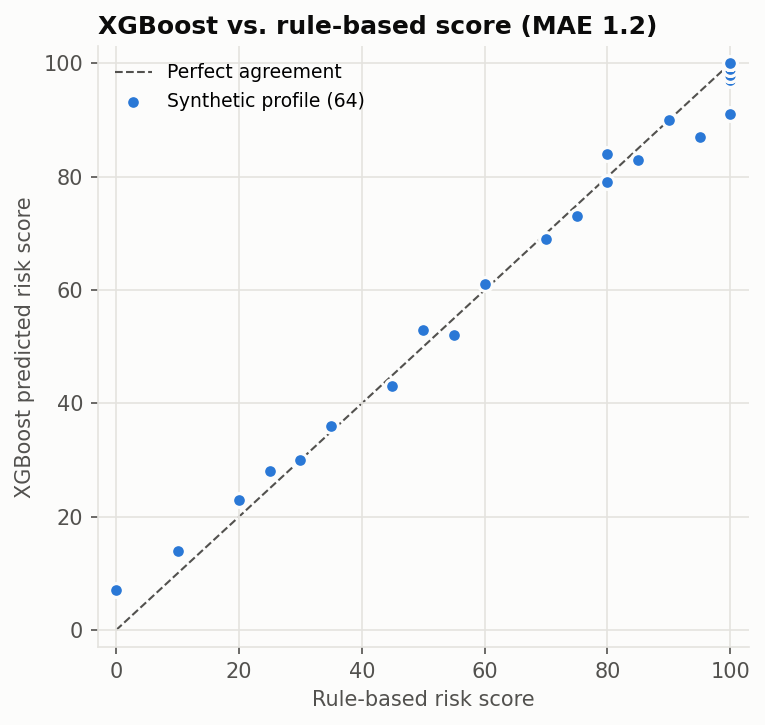
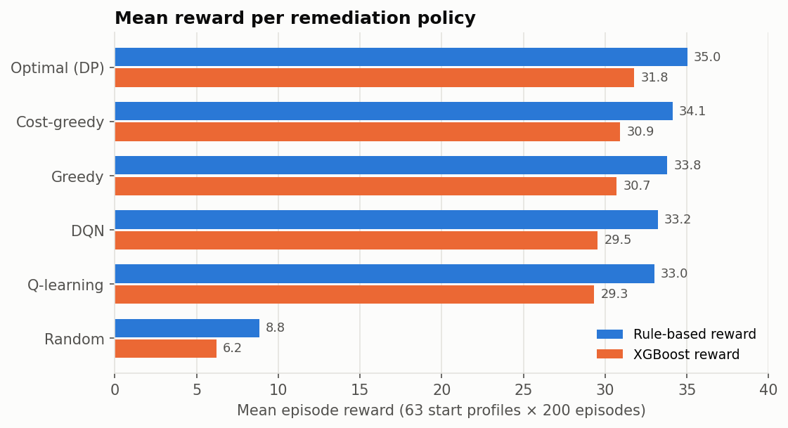
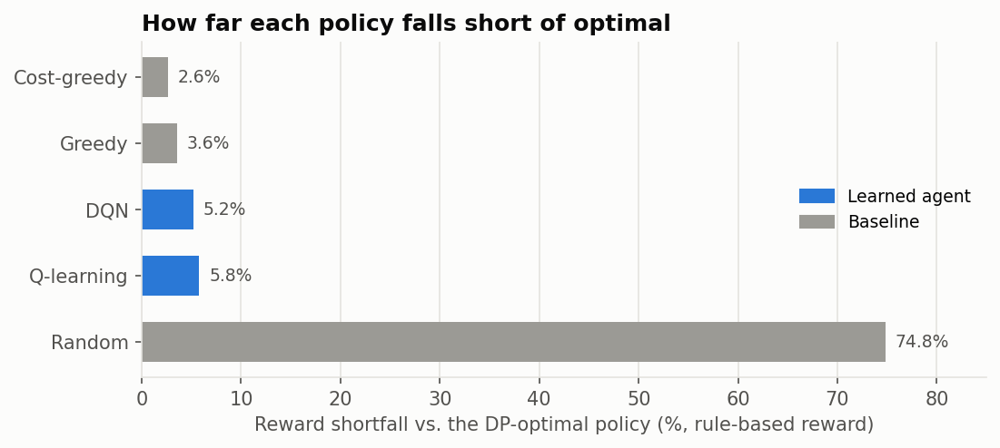
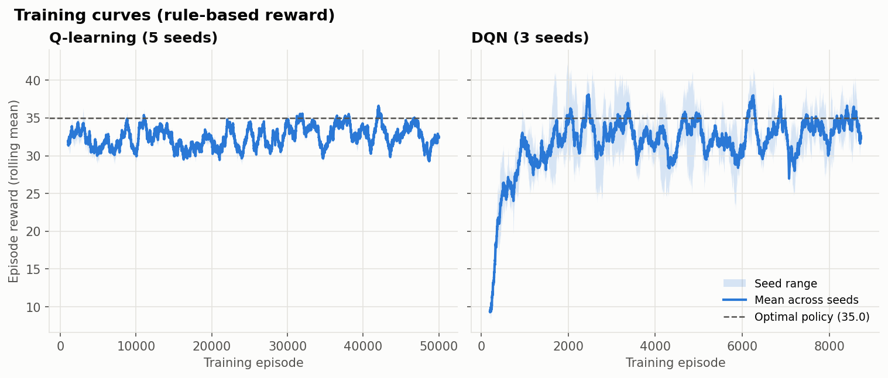
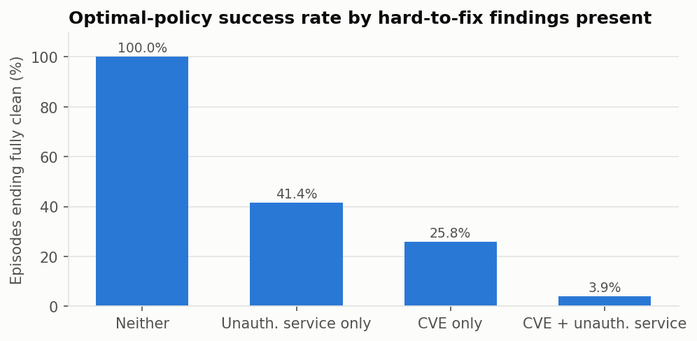
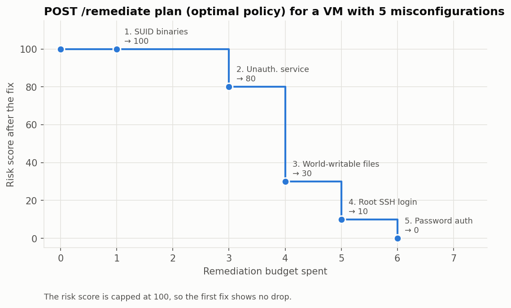

# Riskvane

Standalone service that checks the security posture of VMs and detects active attacks from live logs. Built to be used by [Harbory](https://harbory.preetindersingh.tech/) or any other consumer over a plain HTTP API — no coupling to a specific orchestrator.

## Intent

Most VM security tooling is either a heavyweight compliance suite (OpenSCAP, commercial CSPM tools) or a one-off script that checks a handful of things and stops. This project is meant to be a small, fast, embeddable risk-scoring service: a VM's raw configuration and live logs go in, an explainable risk score and real-time attack alerts come out — cheap enough to run alongside any orchestrator, including Harbory, without needing a dedicated security team's toolchain.

The scoring starts deterministic (CVE matching + hardening rules) because that's auditable and immediately useful, and moves to a trained model once enough real scan data exists — the model's job is to generalize and rank risk across feature combinations faster than a growing pile of if-statements can, not to replace the rules' judgment about what's actually risky.

## What it does

Two independent capabilities under one service:

* **Posture scanning** — point-in-time snapshot of a VM's configuration (open ports, packages, SSH config, file permissions, exposed services) scored for risk.
* **Live attack detection** — streaming analysis of system logs (auth, firewall) for brute-force attempts and port scans, emitted as real-time alerts.

Both halves share a `vm_id` namespace so a consumer can correlate static posture with live alerts for the same VM.

## Architecture

```
┌─────────────┐        ┌──────────────────────────────┐
│  Collector   │───────▶│                              │
│  (per VM)    │  facts │                              │
└─────────────┘        │      Unified service         │
                        │                              │
┌─────────────┐        │  POST /scan   → score+findings│
│ Log parsers  │───────▶│  POST /events → alerts fired  │
│ (auth/fw)    │ events │  GET  /alerts → alerts by vm  │
└─────────────┘        └──────────────────────────────┘
```

One process, one port. The collector and log parsers are library/CLI code that run per-VM and push over plain HTTP; the service holds the scoring rules, the sliding-window aggregator, and the alert store.

## Install

```bash
pip install -e .
```

Optional ML extra (only needed for the trained-model path):

```bash
pip install -e ".[ml]"
```

## Usage

```bash
# collect raw posture facts from the local machine
riskvane-collect --vm-id my-vm --out facts.json

# run the service (port 8000)
riskvane-api

# score the collected facts
curl -X POST localhost:8000/scan -H "Content-Type: application/json" -d @facts.json

# feed normalized log events in, then read alerts back
curl -X POST localhost:8000/events -H "Content-Type: application/json" -d @events.json
curl "localhost:8000/alerts?vm_id=my-vm"
```

## Posture scanning

Collector gathers raw facts only — no scoring at collection time:

* OS, kernel version
* Installed packages + versions (dpkg/rpm)
* Open ports, owning process, listen address
* SSH config (root login, password auth, protocol)
* Unauthenticated service probes (Redis, MongoDB, Memcached)
* Filesystem: world-writable files, SUID binaries (bounded scan budget)
* Process/user counts (running as root, sudo users)

Facts are matched against a locally cached CVE feed and a static rule set (root SSH login, password auth enabled, unauthenticated exposed services, world-writable/SUID files) to produce a deterministic risk score with per-finding explanations.

`POST /scan` → `{ score, severity_breakdown, findings[] }`

Add `?use_model=true` to score with the trained model instead of the rule-based points sum. Findings and severity breakdown always come from the deterministic rules; only `score` changes, and `score_explanation` carries per-feature SHAP contributions. If no trained model is present it silently falls back to the rule-based score.

## Live attack detection

Log sources are parsed into a common event schema, then aggregated into rolling per-VM, per-IP window stats. Alerts fire off threshold rules against those windows.

| Rule | Trigger |
| --- | --- |
| `ssh_brute_force` | 5 failed logins from one IP within 5 minutes |
| `port_scan` | 10 distinct destination ports from one IP within 1 minute |

Alerts de-duplicate: a rule fires once when its window crosses the threshold, and re-arms only after the window ages back below it.

`GET /alerts?vm_id=` → `{ alert_type, severity, source_ip, evidence, raw_event_ids[] }`

## Risk model

Every `/scan` call appends a `(features, label)` row to a local JSONL corpus, tagged `live`. `riskvane-generate-synthetic-corpus` adds 64 synthetic rows tagged `synthetic` — a full 2⁶ factorial over the six risk dimensions the scorer reacts to, spanning score 0 to 100. `riskvane-train-model` trains an XGBoost regressor on that corpus and saves it under `var/models/`.

SHAP explanations come from XGBoost's built-in TreeSHAP (`pred_contribs=True`) rather than the separate `shap` package — same algorithm, no numba/llvmlite dependency.

On the 64 synthetic profiles the trained model tracks the rule-based score closely (MAE ≈ 1.2). It never predicts exactly 0, though: a fully clean VM scores 7.



## RL remediation

`riskvane.rl` trains policies that choose which misconfiguration to fix next under a limited remediation budget.

* **Environment** (`RemediationEnv`, Gymnasium): the observation is the six binary risk dimensions plus remaining budget (`MultiDiscrete([2]*6 + [9])`), and there are six fix actions. Fixes have costs (1–2) and can fail: config changes almost always work, but CVE patches and locking down unauthenticated services often don't. Securing an unauthenticated service can also create world-writable files as a side effect. Reward = drop in risk score (rule engine or trained XGBoost model) − cost, plus a bonus when the VM is fully clean. "Clean" is judged from the state bits, not from score 0, because the model's prediction for a hardened VM isn't exactly 0. Re-fixing something already fixed, or an action the budget can't cover, is penalized.
* **Agents:** tabular Q-learning, and a stable-baselines3 DQN.
* **Baselines:** random, greedy (largest score drop first), cost-greedy (largest drop per unit of cost), and an exact optimal policy solved by dynamic programming. The optimal policy gives the upper bound the learned agents are measured against.

```bash
# train tabular Q-learning and DQN, writing models and histories to var/rl/
riskvane-train-rl

# evaluate random, greedy, optimal, Q-learning and DQN policies on all 64 profiles
riskvane-eval-rl
```

The evaluator writes `results.csv`, `results.json`, and learning-curve PNGs under `var/rl/`. Use `--reward-source model` on either command to score steps with the trained XGBoost regressor instead of the deterministic engine.

### Results

Each policy runs 200 episodes from each of the 63 non-clean profiles. Learned agents are averaged over their training seeds (5 for Q-learning, 3 for DQN).



With the rule-based reward, Q-learning (33.00) and DQN (33.21) come within 6% of the DP-optimal policy (35.03), and random fixing falls 75% short. The simple cost-greedy heuristic still edges out both learned agents: the problem is small enough that ranking fixes by score drop per unit of cost is nearly optimal.





About 42% of episodes end with the VM fully clean, for every non-random policy. That ceiling comes from the environment, not the agents: CVE patches succeed 10% of the time and locking down an unauthenticated service 20%, so hosts with both rarely get fully fixed within the budget.



Regenerate these charts with `python scripts/make_readme_figures.py` after re-running training and evaluation.

### `POST /remediate`

Takes the same `PostureFacts` body as `/scan` and returns an ordered fix plan. Each step lists the dimension, its guidance, the finding IDs it clears, its cost, its success probability, and the score before and after the fix. Scores are recomputed from the VM's actual findings, so they match what `/scan` would return.

```bash
curl -X POST "localhost:8000/remediate?policy=optimal&budget=5" \
  -H "Content-Type: application/json" -d @facts.json
```



`policy` is one of `optimal` (default, needs no training), `greedy`, `cost_greedy`, `qlearning`, or `dqn`. The learned policies load `var/rl/q_table.json` / `var/rl/dqn_model.zip`; if the artifact is missing the endpoint returns 503. `budget` is 0–8, default 8. The plan assumes every fix succeeds. Because real fixes can fail, re-scan and call `/remediate` again after each attempt.

## Roadmap

* [x] Posture collector agent
* [x] CVE matching + rule-based scorer (v0 posture API)
* [x] Auth log parser + normalized events
* [x] Sliding-window aggregator + first alert rules (v0 log-stream API)
* [x] Unified service API (`/scan`, `/alerts`)
* [x] Expand log sources, log (features, label) pairs from rule-based scores
* [x] Synthetic misconfig corpus for labeled training data
* [x] Train tabular risk model (XGBoost) with SHAP explanations
* [x] RL remediation planner (Q-learning, DQN, DP-optimal baseline) + `POST /remediate`

Steps above the line are ML-free and independently useful. The last three exist to generate and consume the training data the model needs.

## Known gaps

The build order is complete, but these were deliberately scoped out and are the honest next steps:

* **No log tailer.** Parsers turn log lines into events, but nothing follows a growing file. Consumers currently read and POST to `/events` themselves.
* **Log sources are auth.log and iptables/netfilter only.** nginx/apache access logs and auditd are parsed by nothing yet.
* **The CVE feed is a 5-entry seed file**, not a synced feed. There is no fetcher; `src/riskvane/data/cve_feed.json` is hand-maintained, and `posture/training/synthetic.py` keeps a matching vulnerable-version map (a test fails loudly if they drift).
* **All state is in-memory.** Alerts and sliding windows reset on restart; there is no database.
* **The model is trained on synthetic data only** and is off by default. On in-distribution inputs it tracks the rule-based score closely (MAE ≈ 1.2), but the synthetic corpus only contains each feature at 0 or its maximum, so intermediate values are extrapolation and can be badly wrong. It needs real accumulated scan data before it's trustworthy — which is why `use_model` is opt-in.
* **Linux only.** The collector's facts (sshd_config, SUID bits, dpkg/rpm) are Linux-specific.

## Status

All build-order steps implemented, plus RL remediation. 129 tests passing.
